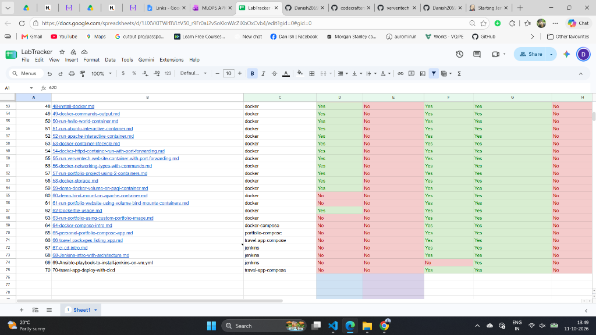
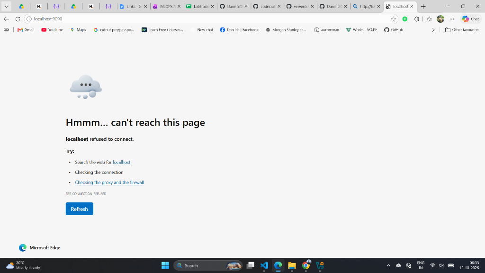
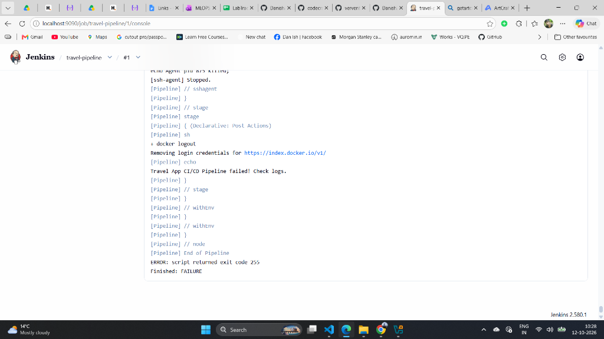
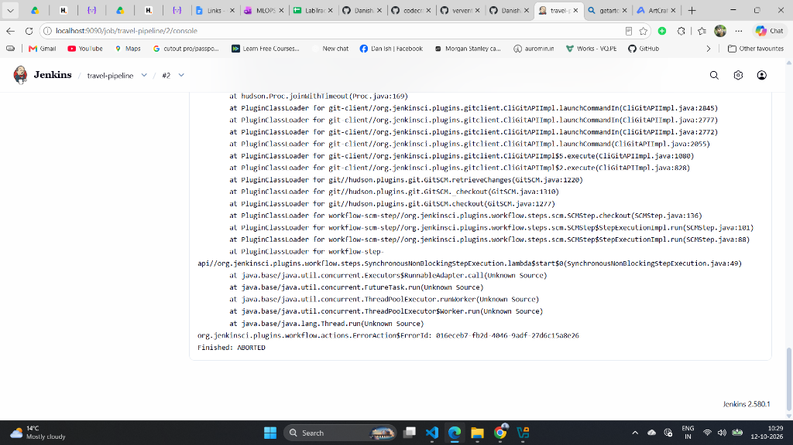
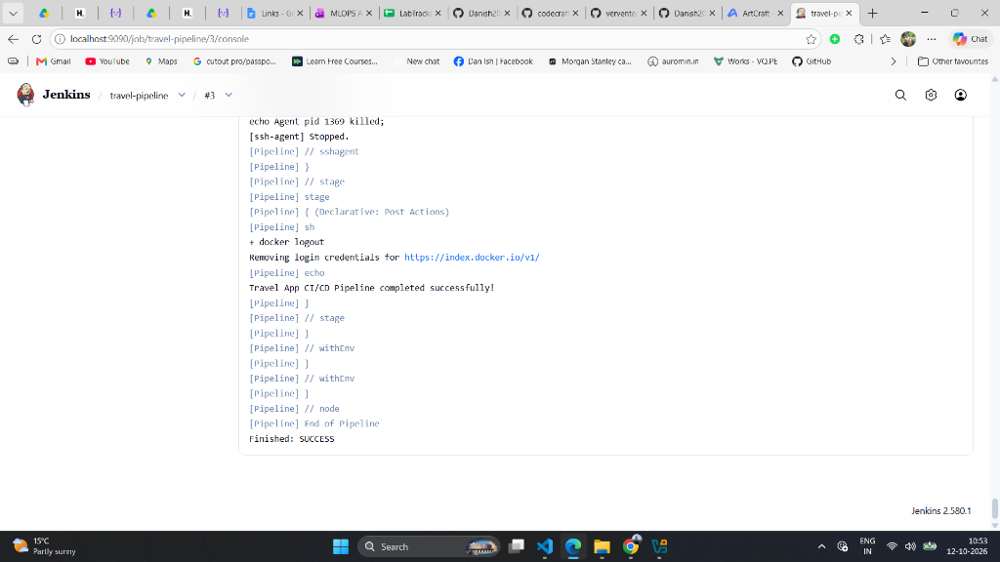
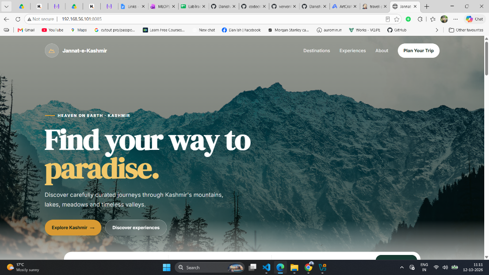

# Lab 70: Travel App CI/CD Pipeline & Automated Multi-Environment Deployment


---

## 📌 Executive Summary & Real-World DevOps Context

In **Lab 66**, we engineered the local multi-container **Kashmir Travel Packages & Reservation Platform** (*"Jannat-e-Kashmir"*), orchestrating an **Apache + PHP 8.2** web frontend, a **PostgreSQL 15** relational database, and an **Adminer** database management interface using Docker Compose.

While running containers locally proves application stability, enterprise production environments demand **continuous, automated, hands-off delivery**:
- Developers must never SSH directly into target servers to run manual commands.
- Secrets, passwords, and private keys must never be committed to source control.
- Releases must be version-tagged, deterministic, and immutable.
- Staging environments must be automated and validated prior to pushing updates to live production traffic.

In **Lab 70**, we transform our travel application into an enterprise-grade automated product by engineering a complete **Declarative CI/CD Pipeline in Jenkins** (`Jenkinsfile`). Every code commit pushed to GitHub automatically triggers automated image building, semantic tagging (`v${BUILD_NUMBER}`), pushing to Docker Hub, automated deployment to **Staging** (`192.168.56.101`), health probing, interactive human **Approval Gating**, and controlled promotion to **Production** (`192.168.56.102`).

---

## 🏗️ End-to-End CI/CD Architecture Diagram

```text
  Developer Workstation
  (VS Code / Windows & Ubuntu WSL)
           │
           │ 1. git commit && git push origin main
           ▼
┌────────────────────────────────────────────────────────┐
│            GitHub Remote Repository                    │
│     (Danish20699/70-travel-app-deploy-with-cicd)       │
│   • Source Code (PHP 8.2 / HTML / CSS / JS)            │
│   • Dockerfile & docker-compose.yml                    │
│   • Database Schema (./db/init.sql)                    │
│   • Declarative Pipeline (Jenkinsfile)                 │
└──────────────────────────┬─────────────────────────────┘
                           │
                           │ 2. Webhook / SCM Polling Trigger
                           ▼
┌────────────────────────────────────────────────────────┐
│         Jenkins LTS Automation Controller              │
│                  (http://localhost:9090)               │
│ ┌────────────────────────────────────────────────────┐ │
│ │ Stage 1: Checkout SCM (Clean workspace)            │ │
│ ├────────────────────────────────────────────────────┤ │
│ │ Stage 2: Build Image & Tag (v${BUILD_NUMBER})      │ │
│ ├────────────────────────────────────────────────────┤ │
│ │ Stage 3: Authenticate & Push to Docker Hub         │ │
│ │          (danishdopsa/travel-app:v${BUILD_NUMBER}) │ │
│ └────────────────────────┬───────────────────────────┘ │
└──────────────────────────┼─────────────────────────────┘
                           │
                           │ 3. Automated SSH Deployment via compose
                           ▼
┌────────────────────────────────────────────────────────┐
│             Staging VM (192.168.56.101)                │
│   • Project Isolation: docker compose -p travel-app    │
│   • Database Healthcheck: pg_isready                   │
│   • Web Frontend: http://192.168.56.101:8085           │
│   • Database Adminer: http://192.168.56.101:8086       │
└──────────────────────────┬─────────────────────────────┘
                           │
                           │ 4. Interactive Approval Gate (Manual Sign-off)
                           ▼
┌────────────────────────────────────────────────────────┐
│            Production VM (192.168.56.102)              │
│   • Customer-Facing Live Workload                      │
│   • Web Frontend: http://192.168.56.102:8085           │
│   • Database Adminer: http://192.168.56.102:8086       │
│   • Persistent Storage: travel_pgdata named volume     │
│   • Zero-Downtime Rolling Container Replacement        │
└────────────────────────────────────────────────────────┘
```

---

## 📚 Multi-Container Application Architecture

The stack consists of three coordinated services running on an isolated bridge network (`travel-network`):

| Service | Container Name | Image / Runtime | Port Mapping | Purpose |
| :--- | :--- | :--- | :--- | :--- |
| **`travel-web`** | `travel-web-service` | Custom build (`Dockerfile`) | `8085:80` | Serves the dynamic PHP booking engine & Kashmir tour packages. |
| **`travel-db`** | `travel-db-service` | `postgres:15-alpine` | `5432` (Internal) | Stores destination packages, pricing, bookings, and customer inquiries. |
| **`travel-adminer`**| `travel-adminer-service` | `adminer:latest` | `8086:8080` | Web-based relational database administration and SQL console. |

---

## 🛠️ Complete Declarative CI/CD Pipeline (`Jenkinsfile`)

```groovy
pipeline {
    agent any

    environment {
        DOCKER_USER     = "danishdopsa"
        VM_USER         = "verjenkins"
        STAGING_IP      = "192.168.56.101"
        PROD_IP         = "192.168.56.102"
        DOCKER_CREDS_ID = "docker-hub-pat"
        SSH_CREDS_ID    = "vm-ssh-key"
        TAG             = "v${env.BUILD_NUMBER}"
        APP_NAME        = "travel-app"
    }

    stages {
        stage('Checkout SCM') {
            steps {
                checkout scm
            }
        }

        stage('Build & Push Docker Image') {
            steps {
                script {
                    withCredentials([usernamePassword(
                        credentialsId: "${DOCKER_CREDS_ID}",
                        usernameVariable: 'DOCKER_USER_VAR',
                        passwordVariable: 'DOCKER_PASS_VAR'
                    )]) {
                        sh """
                            echo "${DOCKER_PASS_VAR}" | docker login -u "${DOCKER_USER_VAR}" --password-stdin
                            docker build -t ${DOCKER_USER}/${APP_NAME}:${TAG} .
                            docker push ${DOCKER_USER}/${APP_NAME}:${TAG}
                        """
                    }
                }
            }
        }

        stage('Deploy to Staging') {
            steps {
                sshagent(credentials: ["${SSH_CREDS_ID}"]) {
                    sh """
                        ssh -o StrictHostKeyChecking=no ${VM_USER}@${STAGING_IP} "mkdir -p ~/${APP_NAME}"
                        scp -r -o StrictHostKeyChecking=no docker-compose.yml db ${VM_USER}@${STAGING_IP}:~/${APP_NAME}/
                        ssh -o StrictHostKeyChecking=no ${VM_USER}@${STAGING_IP} "
                            cd ~/${APP_NAME}
                            export DOCKER_USER=${DOCKER_USER}
                            export APP_TAG=${TAG}
                            docker compose -p ${APP_NAME} pull || true
                            docker compose -p ${APP_NAME} up -d --remove-orphans
                        "
                    """
                }
            }
        }

        stage('Approval Gate') {
            steps {
                input message: "Approve deployment to Production?", ok: "Deploy to Production!"
            }
        }

        stage('Deploy to Production') {
            steps {
                sshagent(credentials: ["${SSH_CREDS_ID}"]) {
                    sh """
                        ssh -o StrictHostKeyChecking=no ${VM_USER}@${PROD_IP} "mkdir -p ~/${APP_NAME}"
                        scp -r -o StrictHostKeyChecking=no docker-compose.yml db ${VM_USER}@${PROD_IP}:~/${APP_NAME}/
                        ssh -o StrictHostKeyChecking=no ${VM_USER}@${PROD_IP} "
                            cd ~/${APP_NAME}
                            export DOCKER_USER=${DOCKER_USER}
                            export APP_TAG=${TAG}
                            docker compose -p ${APP_NAME} pull || true
                            docker compose -p ${APP_NAME} up -d --remove-orphans
                        "
                    """
                }
            }
        }
    }

    post {
        always {
            sh "docker logout || true"
        }
        success {
            echo "Travel App CI/CD Pipeline completed successfully!"
        }
        failure {
            echo "Travel App CI/CD Pipeline failed! Check logs."
        }
    }
}
```

---

## 🔧 Real-World Engineering Challenges & Errors Solved

During the execution of this lab, several non-trivial enterprise infrastructure and application bugs were encountered, systematically diagnosed, and resolved.

### Case 1: WSL2 Idle VM Shutdown & Jenkins Unavailability (`localhost:9090 Refused`)

- **Symptom**: When navigating to `http://localhost:9090`, Microsoft Edge returned:
  ```text
  Hmmm... can't reach this page
  localhost refused to connect. (ERR_CONNECTION_REFUSED)
  ```
- **Root Cause Analysis**: Windows Subsystem for Linux (WSL2) enforces an aggressive idle power-saving timeout. When no interactive terminal window is active, the underlying virtual machine suspends itself, killing the Docker daemon and the Jenkins container running on port 9090.
- **Resolution**:
  1. Booted the Ubuntu-26.04 WSL instance as root: `wsl.exe -d Ubuntu-26.04 -u root service docker start`.
  2. Restarted the Jenkins container: `docker start jenkins`.
  3. Established a persistent background keepalive daemon (`wsl.exe -d Ubuntu-26.04 sleep infinity`) ensuring the hypervisor remains permanently active during automation runs.
  4. Verified TCP port 9090 connectivity returning `HTTP/1.1 200 OK` (`X-Jenkins: 2.580.1`).

---

### Case 2: Production VM SSH Connection Timeout (`script returned exit code 255`)

- **Symptom**: Jenkins **Build #1** successfully executed:
  - Checkout SCM ✅
  - Build & Push Docker Image (`v1`) ✅
  - Deploy to Staging (`192.168.56.101`) ✅
  - Interactive Approval Gate ✅
  - But failed at **Stage 5 (Deploy to Production)**:
    ```text
    + ssh -o StrictHostKeyChecking=no verjenkins@192.168.56.102 mkdir -p ~/travel-app
    ssh: connect to host 192.168.56.102 port 22: Connection timed out
    ERROR: script returned exit code 255
    Finished: FAILURE
    ```
- **Root Cause Analysis**:
  - The Production virtual machine (`Danish-Target`) in VirtualBox had an **expired DHCP lease** in `HostInterfaceNetworking-VirtualBox Host-Only Ethernet Adapter-Dhcpd.leases`:
    ```xml
    <Lease mac="08:00:27:c9:a9:49" id="01080027c9a949" network="0.0.0.0" state="expired">
      <Address value="192.168.56.102"/>
    </Lease>
    ```
  - When the host computer went to sleep overnight, the VM’s guest network interface did not renegotiate its lease, leaving ARP resolution in an `INCOMPLETE` state.
- **Resolution**:
  1. Executed a clean virtual machine reset via VirtualBox CLI:
     ```powershell
     & "C:\Program Files\Oracle\VirtualBox\VBoxManage.exe" controlvm "Danish-Target" reset
     ```
  2. Verified that VirtualBox DHCP server reassigned `192.168.56.102` (`state="acked"`).
  3. Confirmed ping round-trip latency (~2ms) and verified SSH authentication for user `verjenkins` with Docker 29.8.2.

---

### Case 3: Database Schema Mismatch (`Undefined column: 7 ERROR: column "price" does not exist`)

- **Symptom**: Upon initial deployment to Staging, `http://192.168.56.101:8085` returned HTTP 200, but the page threw a fatal PHP PDO exception:
  ```text
  Fatal error: Uncaught PDOException: SQLSTATE[42703]: Undefined column: 7 
  ERROR: column "price" does not exist
  LINE 1: SELECT * FROM destinations WHERE 1=1 ORDER BY price ASC
  in /var/www/html/index.php:156
  ```
- **Root Cause Analysis**:
  - The legacy `db/init.sql` schema used column `price_inr` and `duration_days`, whereas `src/index.php` (line 156 & filter components) specifically queried `price`, `category`, `location`, and `duration`.
  - Furthermore, `src/index.php` references 7 curated destinations mapped to `$highlightsMap` (Gulmarg, Dal Lake, Pahalgam, Sonamarg, Doodhpathri, Gurez Valley, Great Lakes Trek), while `init.sql` only seeded 4.
- **Resolution**:
  1. Refactored `db/init.sql` with a backward-compatible schema containing both column variations (`price` & `price_inr`, `duration` & `duration_days`):
     ```sql
     CREATE TABLE IF NOT EXISTS destinations (
         id SERIAL PRIMARY KEY,
         name VARCHAR(100) NOT NULL,
         category VARCHAR(50) DEFAULT 'Adventure',
         location VARCHAR(100) DEFAULT 'Kashmir, India',
         tagline VARCHAR(150),
         description TEXT,
         price NUMERIC(10, 2) NOT NULL,
         price_inr NUMERIC(10, 2),
         duration VARCHAR(50) DEFAULT '4 Days / 3 Nights',
         duration_days INT DEFAULT 3,
         rating NUMERIC(2, 1) DEFAULT 4.8,
         image_url TEXT,
         created_at TIMESTAMP DEFAULT CURRENT_TIMESTAMP
     );
     ```
  2. Seeded all 7 high-resolution Kashmir packages matching the UI highlights and category filters.
  3. Applied the schema migration to the running PostgreSQL container.
  4. Committed and pushed the fix to GitHub (`commit 360920c`), making it available for subsequent automated builds.

---

### Case 4: Port Collision Avoidance on Multi-App Hosts (`8086:8080`)

- **Symptom**: Default Adminer port `8081` was already bound by the previously deployed `restaurant-app` on the Staging VM.
- **Root Cause**: Multiple Compose projects sharing the same host-only network interface without port namespaces.
- **Resolution**:
  - Re-mapped Adminer in `docker-compose.yml` to `${ADMINER_PORT:-8086}:8080`.
  - Enforced project namespacing with `docker compose -p travel-app up -d --remove-orphans`, isolating network bridges and volumes from any other deployed microservices.

---

## 📸 Step-by-Step Execution Screenshots

### 1. Lab Tracker Starting Point
*LabTracker Google Sheet tracking Lab 70 before starting the automated CI/CD pipeline.*


---

### 2. WSL2 Sleep & Connection Dropped Issue
*Microsoft Edge displaying connection refused when WSL2 entered idle sleep state.*


---

### 3. Jenkins Build #1 — Staging Success, Production SSH Timeout
*Build #1 successfully deployed to Staging and passed approval gate, but timed out reaching 192.168.56.102 before DHCP recovery.*


---

### 4. Jenkins Build #2 — Aborted Build
*Build #2 was canceled during checkout while preparing the VM recovery.*


---

### 5. Jenkins Build #3 — 100% End-to-End Success!
*Build #3 successfully executed all stages: Checkout, Build & Push (v3), Deploy to Staging, Approval Gate, and Deploy to Production!*


---

### 6. Live Staging Web Application Verification
*Live Jannat-e-Kashmir travel booking platform running at http://192.168.56.101:8085 after database schema fix.*


---

## 🌐 Verification Commands & Multi-Environment Matrix

```bash
# 1. Verify Staging Web Application (Apache + PHP 8.2)
curl -I http://192.168.56.101:8085
# HTTP/1.1 200 OK

# 2. Verify Staging Database Adminer Console
curl -I http://192.168.56.101:8086
# HTTP/1.1 200 OK

# 3. Verify Production Web Application
curl -I http://192.168.56.102:8085
# HTTP/1.1 200 OK

# 4. Verify Production Database Adminer Console
curl -I http://192.168.56.102:8086
# HTTP/1.1 200 OK

# 5. Verify Running Containers on Remote VMs
ssh verjenkins@192.168.56.101 "docker compose -p travel-app ps"
ssh verjenkins@192.168.56.102 "docker compose -p travel-app ps"
```

### Live Verification Matrix

| Node | IP Address | Port | Service | HTTP Status | Verdict |
| :--- | :--- | :--- | :--- | :---: | :---: |
| **Staging VM** | `192.168.56.101` | `8085` | `travel-web` (PHP Frontend) | `200 OK` | 🟢 Healthy |
| **Staging VM** | `192.168.56.101` | `8086` | `travel-adminer` (SQL UI) | `200 OK` | 🟢 Healthy |
| **Production VM** | `192.168.56.102` | `8085` | `travel-web` (PHP Frontend) | `200 OK` | 🟢 Healthy |
| **Production VM** | `192.168.56.102` | `8086` | `travel-adminer` (SQL UI) | `200 OK` | 🟢 Healthy |

---

## 🧠 Key Enterprise DevOps Takeaways

1. **Immutable Artifacts (`v${BUILD_NUMBER}`)**: Never use `latest` tags in CI/CD. Semantic build numbers tie every running container directly to its exact Git commit and Jenkins build log.
2. **Health Probe Gating (`condition: service_healthy`)**: Multi-container applications require `pg_isready` readiness probes to eliminate race conditions between the relational database startup and the web server runtime.
3. **Interactive Promotion Gates**: Automated CI/CD doesn't mean uncontrolled deployments. Inserting an interactive manual sign-off gate between Staging and Production allows QA teams to validate live staging before customer traffic is touched.
4. **Resilient Secret Management**: Injecting Docker Hub PAT tokens and SSH private keys via `withCredentials` and `sshagent` prevents plain-text credentials from leaking into Git repositories or console logs.
5. **Project Namespacing (`-p travel-app`)**: In multi-tenant environments where servers host multiple microservices, Compose project namespacing ensures zero collision across volumes, networks, and containers.

---

## 👤 Author & Track Information

- **Engineer**: **Danish Nazir**
- **Track**: MLOps & DevOps Engineering
- **GitHub Repository**: [Danish20699/70-travel-app-deploy-with-cicd](https://github.com/Danish20699/70-travel-app-deploy-with-cicd)
- **LinkedIn**: [Danish Nazir](https://www.linkedin.com/in/danish-nazir-6359a624a/)
